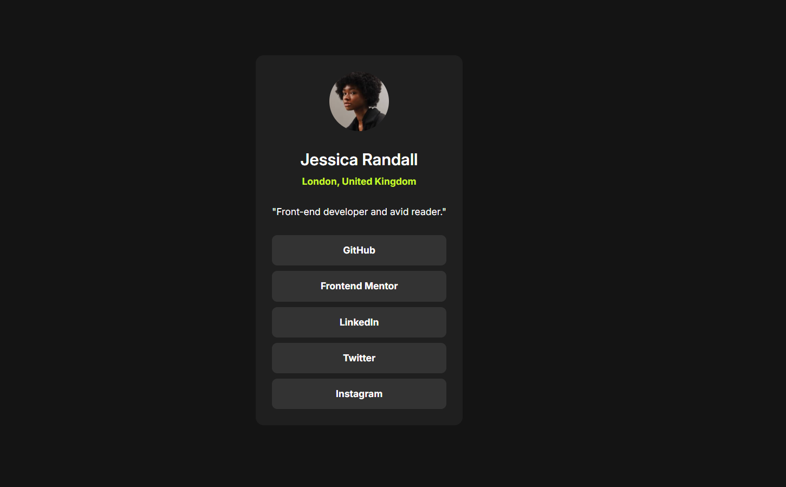

# Frontend Mentor - Blog preview card solution

This is a solution to the [Blog preview card challenge on Frontend Mentor](https://www.frontendmentor.io/challenges/blog-preview-card-ckPaj01IcS). Frontend Mentor challenges help you improve your coding skills by building realistic projects. 

## Table of contents

- [Overview](#overview)
  - [The challenge](#the-challenge)
  - [Screenshot](#screenshot)
  - [Links](#links)
- [My process](#my-process)
  - [Built with](#built-with)
  - [What I learned](#what-i-learned)
  - [Continued development](#continued-development)
  - [AI Collaboration](#ai-collaboration)
- [Author](#author)
- [Acknowledgments](#acknowledgments)

## Overview

### The challenge

Users should be able to:

- See hover and focus states for all interactive elements on the page

### Screenshot

  

### Links

- Solution URL: [Add solution URL here](https://github.com/hossamelgendy101/blog-card)
- Live Site URL: [Add live site URL here](https://blog-card-liard-iota.vercel.app/)

## My process

### Built with

- Semantic HTML5 markup
- CSS custom properties
- Flexbox
- CSS Grid
- Mobile-first workflow

### What I learned

While building this QR code component, I practiced structuring clean HTML and aligning content precisely using Flexbox and precise line-heights to match the design. It helped me reinforce my understanding of responsive design principles and working with style guides.

### Continued development

In future projects, I want to focus more on advanced CSS layouts and improving my workflow efficiency with design tools like Figma.

### AI Collaboration

During this project, I collaborated with an AI assistant (**Claude**) to enhance my workflow and problem-solving process.

- **Tools used:** Claude (as a technical consultant and brainstorming partner).
- **How I used it:** I utilized the AI primarily for **brainstorming solutions** and architectural guidance, specifically when figuring out how to format text lines properly, align elements precisely, and structure the layout elements matching the design requirements.
- **What worked well:** The brainstorming sessions and suggested solutions for text formatting and positioning were extremely accurate and worked seamlessly on the first try. It helped me understand *why* certain CSS approaches work best rather than just providing blind code snippets.
- **What didn't:** Everything went smoothly as I maintained full control over hand-coding and implementing the solutions myself.

## Author

- Website - (https://blog-card-liard-iota.vercel.app/)
- Frontend Mentor -(https://www.frontendmentor.io/profile/yourusername)
- Twitter - (https://www.twitter.com/hossamelgendy)

## Acknowledgments
- Thanks to **Frontend Mentor** for this amazing challenge.
- Thanks to the developer community and AI assistant tools for guidance and brainstorming support.
